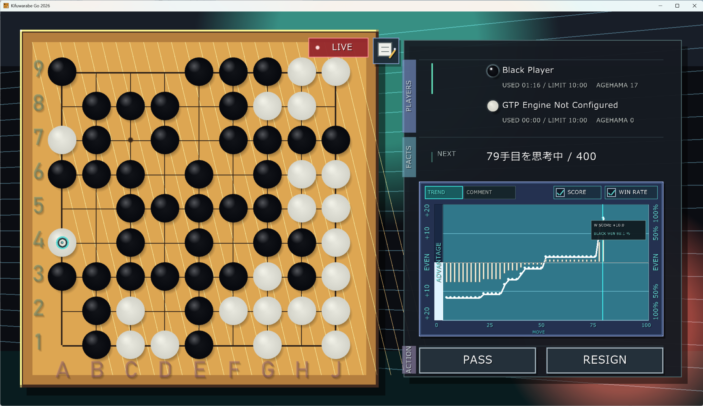

# きふわらべの碁２０２６

［きふわらべの碁２０２６］は、コンピューター囲碁の思考エンジン同士の対局ができるアプリケーションです。人間同士や、人間とコンピューターの対局にも対応しています。

（画面は開発中のものです。v2.5.0）

**このアプリについて、何を知りたいですか？**

- **使いたい**
    - **[どういうアプリ](./docs/User/Products/README.md)** — このアプリでできること、画面の例はこちら。
    - **[始め方](./docs/User/Installation/README.md)** — ダウンロードからアプリのウィンドウを開くまでの手順はこちら。
        - **[最新版のダウンロード](https://github.com/muzudho/KifuwarabeGo2026/releases/latest)** — GitHubのリリースページ。
- **開発したい**
    - **[開発日誌](./docs/Dev/Log/2026/11.md)** — 最新の開発日誌（2026年11月）。
    - **[開発者向けドキュメント](./docs/Dev/README.md)** — 開発環境、設計、実装計画などはこちら。

## ライセンス

[MIT License](./LICENSE.txt)
